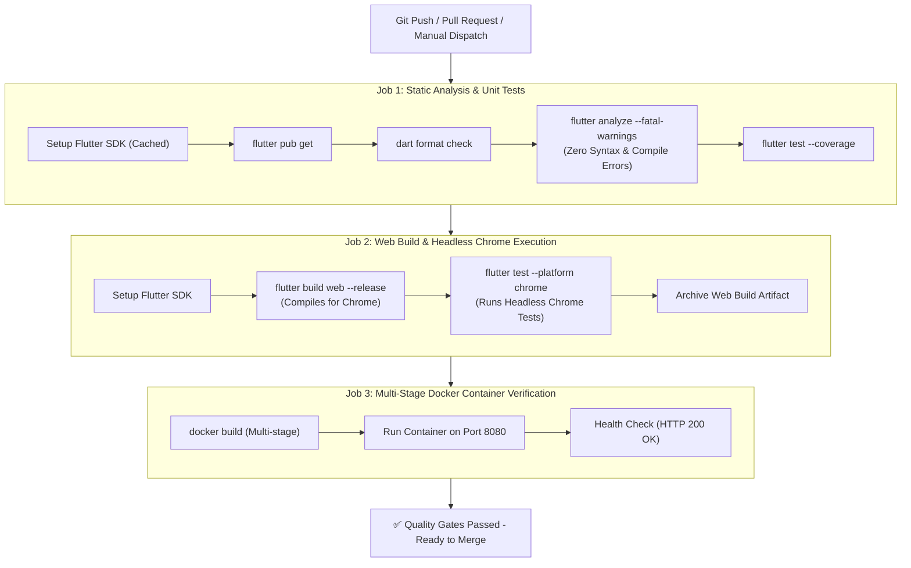

# CI/CD Pipeline Architecture & Quality Gates
# SW2627: Diagnostic Lab Management (LabTrack)

This document describes the Continuous Integration and Continuous Delivery (CI/CD) architecture implemented for **LabTrack**.

---

## 🏗️ Pipeline Overview

Whenever a commit is pushed or a Pull Request is opened against `main`, `master`, `develop`, or feature branches, GitHub Actions automatically executes our multi-tier CI/CD pipeline.



---

## 🛡️ The Three Quality Gates

### Gate 1: Code Integrity & Error Prevention
- **Tool**: `flutter analyze --fatal-warnings`
- **Objective**: Prevents broken builds, unresolved symbols, missing parameters, type mismatches, or missing color tokens (such as `AppColors.infoDark`) from ever reaching the repository.
- **Fail Condition**: Any syntax error, compile error, or code warning terminates the workflow immediately.

### Gate 2: Web & Chrome Target Validation
- **Commands**:
  ```bash
  flutter build web --release
  flutter test --platform chrome
  ```
- **Objective**: Guarantees that the app compiles properly to Web/Chrome, all assets/HTML/JS bundles generate without runtime errors, and executes tests headlessly in a real Google Chrome instance.
- **Artifact**: Uploads the production web build archive (`labtrack-web-release`) to GitHub Actions for direct inspection.

### Gate 3: Production Docker Container Health Check
- **Commands**:
  ```bash
  docker build -t labtrack:ci-test .
  docker run -d --name test-app -p 8080:8080 labtrack:ci-test
  curl -s -o /dev/null -w "%{http_code}" http://localhost:8080
  ```
- **Objective**: Validates that the multi-stage Docker build compiles the Flutter Web artifacts and serves them cleanly via Nginx on Alpine Linux with HTTP 200 status.

---

## 🚀 Running the Pipeline Locally

Developers can run the exact same verification locally before pushing to prevent CI failures:

### On Windows (PowerShell):
```powershell
.\scripts\verify.ps1
```

### On Linux / macOS / Git Bash:
```bash
chmod +x scripts/verify.sh
./scripts/verify.sh
```

---

## 🤖 GitHub Actions Workflow Configurations

| Workflow File | Purpose | Trigger Events |
|---|---|---|
| [`.github/workflows/ci.yml`](../.github/workflows/ci.yml) | Code analysis, unit tests, Chrome web build, and Docker health test | Push, PR, and `workflow_dispatch` |
| [`.github/workflows/deploy-pages.yml`](../.github/workflows/deploy-pages.yml) | Automated CD deployment to GitHub Pages | Push to `main`/`master` |

---

## 🔒 Branch Protection Best Practices

To enforce these quality gates on GitHub:
1. Navigate to **Settings** ➔ **Branches** ➔ **Branch protection rules**.
2. Select your base branch (`main` or `master`).
3. Enable:
   - ✅ **Require a pull request before merging**
   - ✅ **Require status checks to pass before merging**
   - ✅ Select required status checks:
     - `🔍 Static Analysis & Unit Tests`
     - `🌐 Web Compilation & Chrome Execution`
     - `🐳 Docker Multi-Stage Build & Container Smoke Test`
