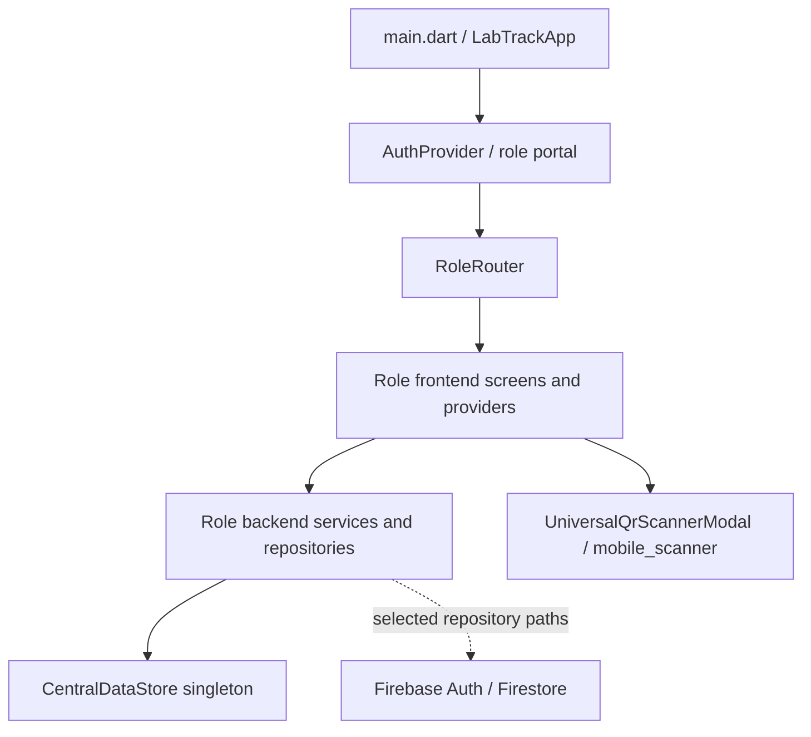

# High-level design

## Runtime architecture

The active entry point is [`lib/main.dart`](../lab_track/lib/main.dart).
It attempts Firebase initialization, logs initialization failures, and launches
`LabTrackApp`. Provider supplies authentication, patient, phlebotomist and
front-desk state. Lab/admin screens manage their own role state.

`AuthProvider` selects the role portal when unauthenticated. After authentication,
[`RoleRouter`](../lab_track/lib/routing/role_router.dart) maps the user's role to
one of five dashboards: patient, phlebotomist, front desk, lab technician or admin.
The pathologist workflow is part of the lab role, not a sixth authorization role.

## Source organization

Active role modules live under `lib/auth`, `lib/patient`, `lib/phlebotomist`,
`lib/frontdesk`, `lib/lab` and `lib/admin`, with `frontend` and `backend`
subdirectories. `lib/data` holds common models, repositories, services and seeds;
`lib/domain` holds canonical enums and the sample state machine. Shared scanner,
theme and custody widgets live under `lib/shared`.

The older `lib/features` tree coexists with these modules. Follow imports from
`main.dart` and `RoleRouter` when finding active screens; do not assume every
duplicate screen is on the launched route. Several core/service files remain
comment-only scaffolding.

## Shared operational data

[`CentralDataStore`](../lab_track/lib/data/services/central_data_store.dart) is
a `ChangeNotifier` singleton holding orders, samples, reports, branches, staff,
racks, analyzers and QC records. Role services read and mutate this shared state.
For example, booking creates an order; collection adds a sample; lab accessioning
and result authorization update that sample and report; front-desk and patient
views can then observe the updated data within the same application process.

The store initializes branches, sample orders/reports and 100 users (50 patients,
20 phlebotomists, 12 lab technicians, 12 front-desk staff and 6 admins). These are
demonstration fixtures, not a production population. Data is reset when the
process restarts; this is not a distributed event-sourced backend.

## Integration boundaries

- Firebase Auth and Firestore are used in selected authentication/repository paths.
  Demo-role access, seeded-user login and offline fallbacks are also present.
  UI routing alone does not establish server-enforced authorization.
- Live barcode/QR capture uses `mobile_scanner`; manual input and demo presets
  support camera-denied and emulator scenarios. Camera availability depends on
  device/browser permissions.
- Custody records include optional location and temperature metadata. The
  existence of those fields does not guarantee sensor capture on every action.
- Notification and storage service files are scaffolding. Report signing is an
  application-state operation; report download/printing controls include feedback
  placeholders rather than a verified PDF/printer integration.
- Persistent operational writes, backend access rules, durable audit storage,
  offline conflict resolution, push delivery and production compliance remain
  integration/validation work. No uptime or search-latency benchmark is claimed.

## Delivery

Flutter web is built for static hosting. The Docker image builds the web bundle
and serves it through Nginx on port 8080. GitHub Actions checks analysis/tests,
web/Chrome, Docker and Android APK generation; Pages deploys on main/master
pushes. See [CI/CD](CICD.md) for exact gates and deployment limitations.
